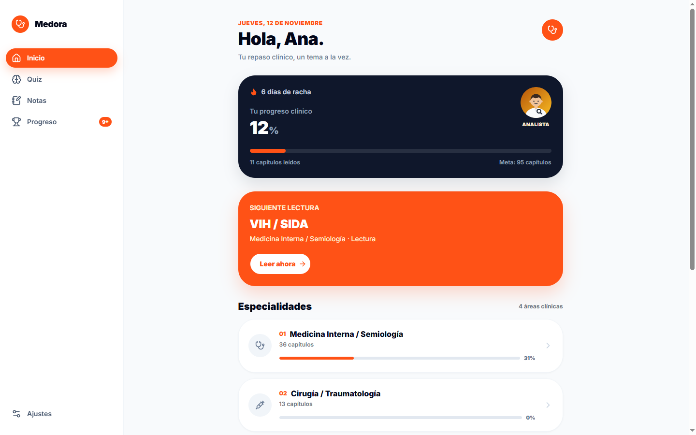

# Medora

Medora is a Spanish-language medical revision app: read one short clinical chapter, answer five questions on it, and see what to open next.

**[Open the live app](https://medora-sooty.vercel.app/)** — sign up with any email; no card, no invite.

Built solo with Next.js 16, React 19 and Supabase: cookie-based auth, Postgres row-level security, a corpus checked by its own tests, and 165 Vitest tests over the study rules.

**Status:** actively developed solo project in open beta, free while Premium stays unbuilt. There is no payment flow, no mobile app and no social layer yet, and the UI is Spanish only. Medora is study material, not medical advice.



## The study loop

- **Read.** 95 main chapters, 147 summaries and 17 review chapters across internal medicine, surgery, gynecology and pediatrics, with figures.
- **Take notes.** 51 clinical topics with search, filters, grid/list views, and personal notes anchored to a chapter paragraph.
- **Answer.** 501 quiz questions and authored clinical cases, per specialty or random. A round is five questions with immediate correction and a server-computed star rating.
- **Repeat.** Progress, a streak that is not lost before your first session of the day, levels and achievements computed from your own answers.

UI copy is Spanish; identifiers, routes and slugs are English (`/dashboard/reading/surgery`, topic `acute-inflammation`).

Unlike a subscription question bank, Medora is free, in Spanish, and built around short chapters instead of a large exam simulator. The closed loop — chapter, five questions, what comes next — is the whole product.

## Run it locally

Requires Node.js >= 20.9 and pnpm 11 (pinned in `package.json`).

```bash
pnpm install
cp .env.example .env.local   # Windows: copy .env.example .env.local
pnpm dev
```

Fill `NEXT_PUBLIC_SUPABASE_URL` and `NEXT_PUBLIC_SUPABASE_ANON_KEY` in `.env.local`, then in the Supabase dashboard:

1. Authentication → Providers → Email: disable **Confirm email** (signup returns a session immediately).
2. Authentication → URL Configuration: Site URL `http://localhost:3000`, redirect `http://localhost:3000/auth/callback`.
3. Apply the migrations in `supabase/migrations/`.

Without `RESEND_API_KEY` and the Upstash credentials the app still runs: emails are logged and skipped, and rate limiting falls back to memory.

**Deploy:** hosted on Vercel. Set `NEXT_PUBLIC_SITE_URL` to the deployed origin and add the same redirect URL to Supabase.

## How it is built

| Area | Decision |
| --- | --- |
| Auth | Supabase email/password with cookie sessions via `@supabase/ssr`. The dashboard is gated server-side with `requireUser()`, and reset links are built from `NEXT_PUBLIC_SITE_URL`. |
| Abuse control | Server actions validate with zod; signup rejects disposable domains and is rate limited with Upstash Redis when configured, in memory otherwise. |
| Data | Six Postgres tables with RLS, every read and write on the user's own JWT — the app never uses `service_role`. Quiz results are append-only; streak days are written only by a database trigger; unlocked achievements are persisted, so a broken streak never revokes one. |
| Content | A clinical corpus in `data/medical`, trimmed from the Pulso set by script (`data/medical/README.md`) and resolved server-side by English slugs (`src/lib/content/slugs.ts`). A unit test fails if a slug drifts, collides or drops a topic. |
| Email | Resend + React Email templates for welcome, password reset and password changed. Without a key the app skips the send instead of failing signup. |
| Tests | Vitest covers the rules that are easy to get wrong: streaks, achievement unlocks, quiz scoring, progress and slug integrity. ESLint and TypeScript run on every build. |
| Hardening | CSP, HSTS and frame/permissions headers in `next.config.mjs`; Vercel Analytics in production. |

## Scripts

| Command | What it does |
| --- | --- |
| `pnpm dev` | Start the dev server |
| `pnpm build` | Production build (runs type checking) |
| `pnpm start` | Serve the production build |
| `pnpm lint` | ESLint across the repo |
| `pnpm test` | Run the Vitest unit tests |
| `pnpm email` | Preview the React Email templates |

## Project structure

```
src/
  app/            routes: landing, auth, protected dashboard, privacy and terms
  components/     app shell, bottom nav, markdown reader, achievement dialogs
  emails/         React Email templates (welcome, reset, password changed)
  lib/auth/       zod schemas, server actions, rate limit, disposable domains
  lib/content/    corpus loader, English slug map and types
  lib/quiz-bank/  the question bank, split by specialty
  lib/user-data/  queries and pure study rules (streak, progress, achievements)
  lib/supabase/   browser and server clients
  proxy.ts        session refresh + x-pathname (no route gating)
data/medical/     trimmed clinical corpus (JSON, not edited by hand)
data/cases/       curated and authored clinical cases
supabase/         migrations and the before-user-created Auth Hook
public/           reading figures under lectura/, resumen/ and repaso/
```

## Docs

- [Auth contract](docs/AUTH.md) — sessions, gating, rate limits, disposable domains
- [User data](docs/USER-DATA.md) — tables, RLS and the streak trigger
- [Content](docs/CONTENT.md) — corpus layers, slug map and routes
- [Emails](docs/EMAILS.md) — Resend, Auth Hooks and templates
- [Manual steps](docs/MANUAL-STEPS.md) — keys, deploy and hooks
- Authoring: [quiz bank](docs/QUIZ-BANK.md) · [clinical cases](docs/CASE-AUTHORING.md)

## Roadmap

Persistence, streaks, quiz rounds and achievements are shipped ([ROADMAP.md](ROADMAP.md)). Next is social features and leaderboards, and only once there are real users.

## Licence

MIT — see [LICENSE](LICENSE).

Built by [Roberto](https://github.com/JORDANROBERTO74).
